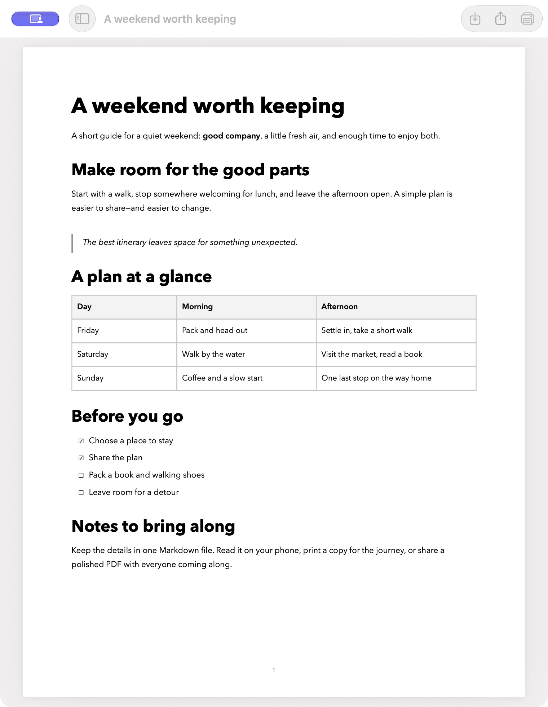
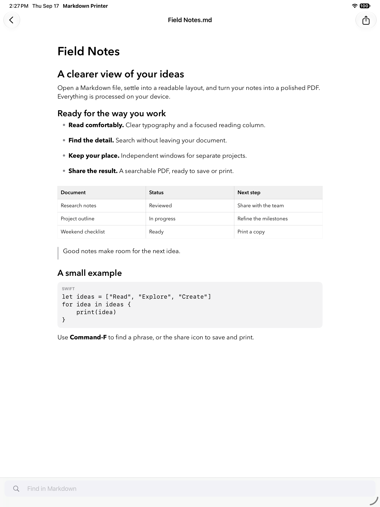
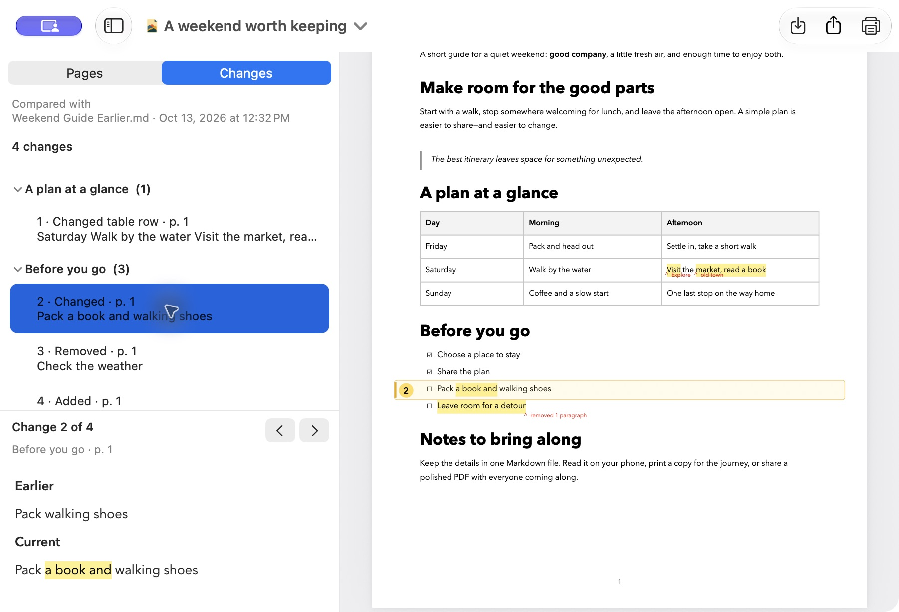

  

<h1 align="center">Markdown Printer</h1>

<strong>Give your Markdown a finished page.</strong> Read comfortably. Share a polished PDF. Print something worth keeping.

  <a href="https://github.com/pedstrom/md-printer/releases/latest/download/Markdown-Printer.zip"><strong>Download for Mac · Free</strong></a> 
  <a href="https://apps.apple.com/app/id6811229585"><strong>Get the iPhone and iPad app · Paid download</strong></a>

AI conversations, project notes, research, and plans often end up as Markdown files. Markdown Printer turns them into documents you can read, hand to someone, or bring to a meeting—with thoughtful typography, clean tables, and searchable text. Everything is rendered on your device, without an account or uploading your document.

<table>
  <tr>
    <td width="50%"></td>
    <td width="50%"></td>
  </tr>
  <tr>
    <td><strong>A finished page on Mac.</strong> Ready to save, share, or print.</td>
    <td><strong>A comfortable reader on iPad.</strong> PDF sharing is a tap away.</td>
  </tr>
</table>

## From Markdown to something you can use

- **Share a finished document.** On Mac, drop in a file and save, print, or drag its PDF into another app. Need an editable handoff? Export Microsoft Word instead.
- **See what changed.** Compare a document with an older file or a Git version on Mac. Review complete earlier and current passages, with the contributing Git commit descriptions above each selected change, then share a PDF or Word copy with the changes marked.
- **Keep writing in your favorite editor.** Open Mac previews refresh as the source changes, keeping your place. Drop a whole batch of files to open each in its own window.
- **Read wherever you are.** Preview Markdown in Finder with Space. On iPhone and iPad, open it from Files and read with adjustable text, selectable passages, and scrolling tables and code. Keep several documents open in separate iPad windows.
- **Enjoy the page.** Avenir Next typography, clear headings, local images, lists, footnotes, and properly monospaced code give your notes room to breathe. The Mac preview is the PDF you save or print.

## Get started

**Mac · macOS 14 Sonoma or newer · Apple silicon and Intel**

Download the ZIP above, unzip it, and move **Markdown Printer** to Applications. Open the app and drop in a Markdown file. The Mac release is signed and notarized by Apple; future updates are available from **Markdown Printer > Check for Updates…**.

**iPhone and iPad · iOS/iPadOS 26 or newer**

Install from the App Store, choose a Markdown file in Files, and use the share icon to save, send, or print a PDF. The paid app supports the project's continued development.

Your source files stay unchanged. Local images resolve beside the Markdown file. Secure remote images download automatically; on Mac, you can turn this off in Settings > General. Finder Quick Look stays offline. See the [privacy policy](docs/privacy-policy.md) for details.

## Explore further

- [Mac guide](docs/mac-guide.md) — exporting, comparing versions, Finder previews, and shortcuts.
- [iPhone and iPad guide](docs/ios-support.md) — Files, windows, sharing, and troubleshooting.
- [Markdown support](docs/markdown-support.md) — formatting, images, links, and compatibility.
- [Development guide](development/README.md) — build, modify, test, and contribute.
- [Release notes](release-notes/) · [All documentation](docs/README.md) · [Report an issue](https://github.com/pedstrom/md-printer/issues).

## Made for a practical need

I started Markdown Printer because I wanted the growing pile of AI-generated Markdown on my Mac to look good on paper. It has grown into a native reader and document-sharing tool for Mac, iPhone, and iPad.

— Peter Edstrom

If it earns a place in your workflow, you can [buy me a coffee](https://buymeacoffee.com/peteedstrom) to support more small, practical, independent tools.

The Mac app and shared core are open source under [MIT](LICENSE). Mobile-specific code is [source-available](LICENSE-IOS.md): personal builds, use at work, and free sharing are welcome; monetized redistribution requires written permission. Documents you create are yours to use commercially.
